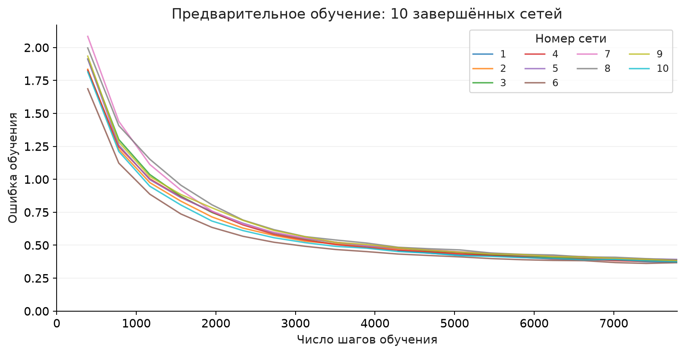
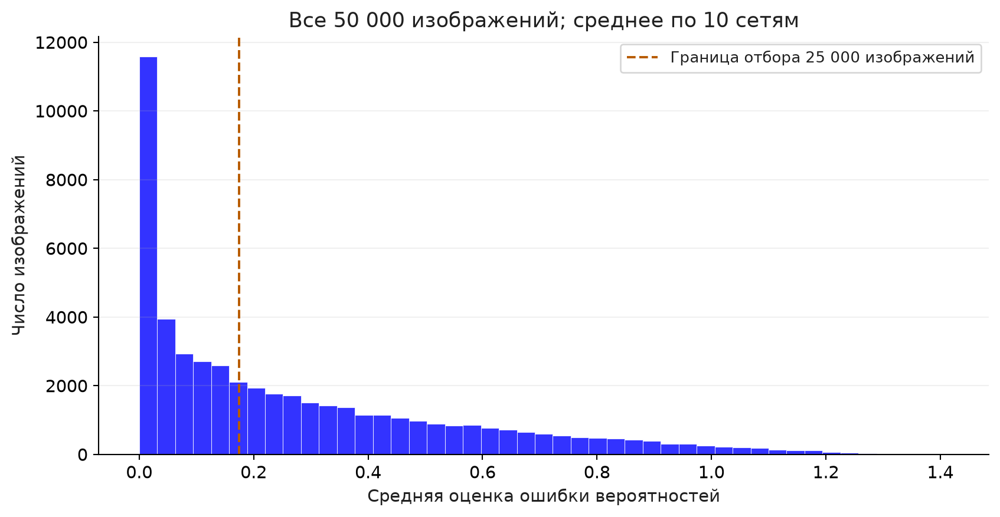
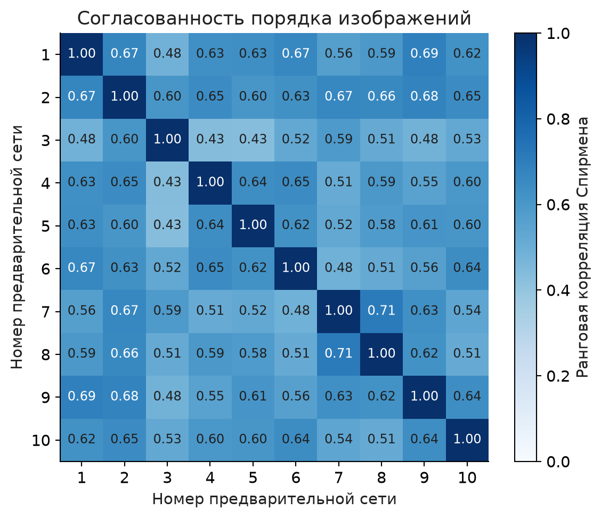
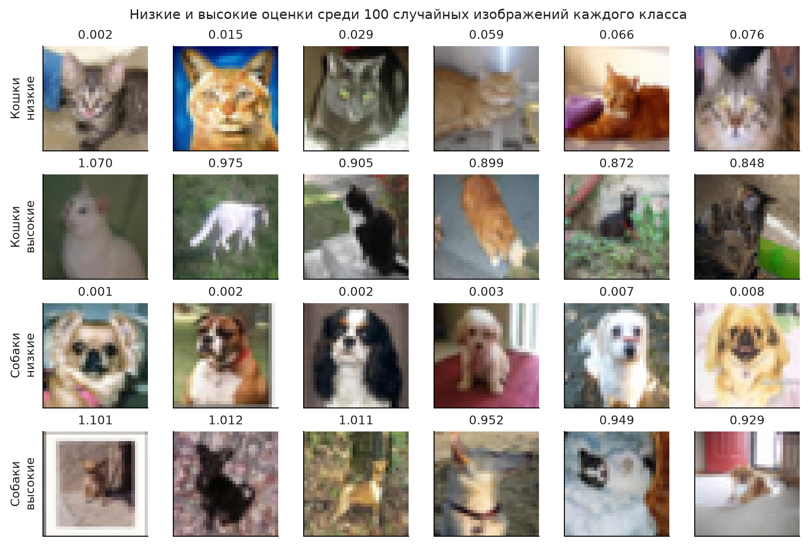
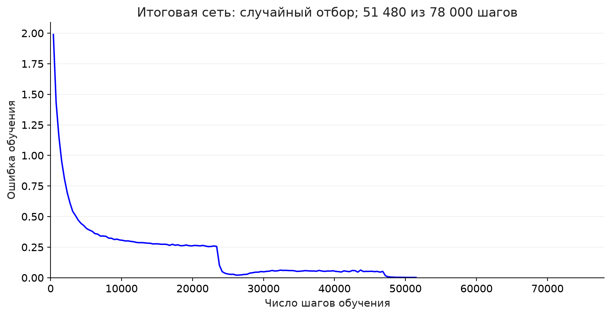

# Efficient Neural Networks — Homework 2

[English](#english) · [Русский](#русский)

## English

Reproduction study of **Deep Learning on a Data Diet: Finding Important Examples Early in Training** by Mansheej Paul, Surya Ganguli, and Gintare Karolina Dziugaite. This project uses the [corrected second version](https://arxiv.org/abs/2107.07075v2) and the [authors’ implementation](https://github.com/mansheej/data_diet).

**Intermediate release.** The published snapshot, dated **11 October 2026, 20:16 UTC** (12 October, 01:16 in Yekaterinburg), contains **10 of 10 completed preliminary networks and 0 of 8 final trainings**. The first final network, trained on a random half, has reached **51,480 of 78,000 updates** in this snapshot. The training continues separately. There is no measured final accuracy comparison yet, and this repository does not claim successful reproduction of the paper’s main result.

### Materials

- [Single notebook: training, validation, and plots](hw2/colab.ipynb) · [Open in Colab](https://colab.research.google.com/github/Mixlazer/Efficient-NN-HW-2/blob/main/hw2/colab.ipynb)
- [Report in Russian](hw2/report.pdf) · [Text version](hw2/report.md)
- [Seven-slide presentation in Russian](hw2/presentation_v4.pptx)
- [Instructions and methodological details](hw2/README.md)
- [Raw measurements](hw2/results/) · [Portable data snapshot](hw2/results_snapshot.zip) · [Independent checks](hw2/results/analysis.json)

The notebook includes all experiment code and the unchanged architecture from the authors’ implementation. It runs the saved-data analysis by default; set `RUN_TRAINING = True` in Google Colab with **Tesla T4** to train. Checkpoints can be downloaded and uploaded through Colab’s Files panel; Google Drive is not required.

### Experiment

The **training set** contains the images used to train a network. The **test set** contains separate images used to measure its accuracy. **Accuracy** is the fraction of correctly classified images. CIFAR-10 contains 50,000 training images and 10,000 test images, divided into ten classes. **ResNet-18** is a network with eighteen layers and connections between its blocks; we use the unchanged architecture from the authors’ implementation.

The **error L2 norm**, abbreviated **EL2N** in the paper, is the Euclidean distance between predicted class probabilities and the correct-answer vector. This vector contains one for the correct class and zeros for all other classes. We average **ten separate distances** for each training image and retain the 25,000 images with the highest mean scores.

A **training step** is one weight update using a batch of 128 images. An **epoch** is one pass through a dataset. We compare a randomly selected half of the training set with a half selected using the paper’s method.

| Stage | Agreed configuration |
|---|---|
| Preliminary scoring | 10 ResNet-18 networks; all 50,000 CIFAR-10 training images; 7,800 updates each |
| Final comparison | Random 25,000 images vs. EL2N-selected 25,000 images |
| Repetitions | 4 per method, paired initial weights; 78,000 updates each |
| Evaluation | All 10,000 test images, evaluated after the last update |
| Compute | Google Colab, NVIDIA Tesla T4, 32-bit floating-point arithmetic |

The final model trained on all 50,000 images is intentionally omitted. Therefore this limited reproduction can compare selection methods, but cannot directly verify accuracy preservation relative to training on the full dataset. Keeping the update budget also means that halving the dataset does not establish a twofold compute reduction.

### Measured preparation stage

These curves show that the preliminary networks learned. They do **not** establish better held-out accuracy after selection. The absent first 3,900 updates of the imported first run were not reconstructed in the plot.

The mean score for each image is calculated from all ten completed networks and matches the saved selection scores exactly. The dashed line marks the threshold for retaining 25,000 images. The histogram shows the score distribution, but does not establish an advantage of the method.

**Spearman rank correlation** measures how similarly two networks order images by their scores. The off-diagonal correlations range from **0.43 to 0.71** in this snapshot. Agreement of scores is a diagnostic; the final comparison still requires eight completed trainings.

The examples are selected automatically by taking extreme scores among 100 randomly sampled images per class. A high score may indicate a difficult image or an incorrect label. The usefulness of selection is tested by separate training runs, not by visual resemblance to illustrations in the paper.

The random-half network has completed 51,480 updates. This training-loss curve contains only observed steps; no test accuracy is available yet.

All of our figures are generated by notebook cells; the report and presentation reuse these files. The paper’s original Figure 1 is explicitly attributed and kept separate from our measurements.

### Final verification

After all repetitions finish, accuracy will be recalculated from the saved class probabilities. The selected image indices, number of training steps, and average of the ten networks’ scores will also be checked independently.

The **sample standard deviation** describes the variation in accuracy between repetitions. A **percentile** is a value below which a specified proportion of results lies. For each selection method, we will report the mean accuracy, sample standard deviation, and 16th and 84th percentiles. These percentiles describe the spread of four repetitions; they are not a confidence interval.

### Implementation provenance

The architecture comes from commit `aee462eab93aa0fb14c1ddfeba45d645b85a5fbb` of the authors’ repository and is distributed under [Apache 2.0](hw2/author_LICENSE.txt). Differences from the authors’ environment are listed in the [experiment instructions](hw2/README.md) and configuration. Sources, checksums, and the history of the imported checkpoint are available in the [results directory](hw2/results/).

## Русский

Проверка статьи **«Глубокое обучение на диете из данных: поиск важных примеров в начале обучения»** Мэншиджа Пола, Сурьи Гангули и Гинтаре Каролины Дзюгайте. Используются [исправленная вторая версия статьи](https://arxiv.org/abs/2107.07075v2) и [код авторов](https://github.com/mansheej/data_diet).

**Промежуточная редакция.** Снимок от **12 октября 2026 года, 01:16 по Екатеринбургу** (11 октября, 20:16 UTC) содержит **10 из 10 завершённых предварительных сетей и 0 из 8 итоговых обучений**. Первая итоговая сеть, обучаемая на случайной половине, выполнила **51 480 из 78 000 шагов** в этом снимке. Вычисления продолжаются отдельно. Итогового сравнения точностей пока нет; успешное воспроизведение главного результата статьи в этом репозитории не заявляется.

### Материалы

- [Единый блокнот с обучением, проверками и графиками](hw2/colab.ipynb) · [Открыть в Colab](https://colab.research.google.com/github/Mixlazer/Efficient-NN-HW-2/blob/main/hw2/colab.ipynb)
- [Отчёт на русском языке](hw2/report.pdf) · [Текст отчёта](hw2/report.md)
- [Презентация на русском языке: семь слайдов](hw2/presentation_v4.pptx)
- [Порядок запуска и описание опыта](hw2/README.md)
- [Исходные измерения](hw2/results/) · [Архив данных](hw2/results_snapshot.zip) · [Результат независимых проверок](hw2/results/analysis.json)

Блокнот содержит весь код опыта и неизменённую архитектуру из реализации авторов. По умолчанию выполняется анализ сохранённых измерений; для обучения установите `RUN_TRAINING = True` в Google Colab с **Tesla T4**. Сохранения можно скачивать и загружать через панель «Файлы» Colab; Google Диск для этого не нужен.

### Условия опыта

**Обучающая выборка** — изображения, по которым сеть учится. **Проверочная выборка** — отдельные изображения для оценки точности. **Точность** — доля правильно распознанных изображений. Набор CIFAR-10 содержит 50 000 обучающих и 10 000 проверочных изображений, разделённых на десять классов. **ResNet-18** — сеть с восемнадцатью слоями и связями между её блоками; её архитектура взята без изменений из реализации авторов.

**Оценка ошибки вероятностей**, в статье обозначенная **EL2N**, — евклидово расстояние между предсказанными вероятностями классов и вектором правильного ответа. У нужного класса в таком векторе стоит единица, у остальных — нули. Для каждого обучающего изображения усредняются **десять отдельных расстояний**. Итоговый отбор сохраняет 25 000 изображений с наибольшей средней оценкой.

**Шаг обучения** — одно обновление весов по порции из 128 изображений. **Эпоха** — один проход по выборке. Сравниваются случайная половина обучающей выборки и половина, выбранная методом статьи.

| Этап | Согласованные условия |
|---|---|
| Предварительное оценивание | 10 сетей ResNet-18; все 50 000 обучающих изображений CIFAR-10; по 7 800 шагов |
| Итоговое сравнение | Случайные 25 000 изображений и 25 000 изображений, отобранных по EL2N |
| Повторения | По 4 на способ, начальные веса попарно одинаковы; по 78 000 шагов |
| Проверка | Все 10 000 проверочных изображений, оценка после последнего шага |
| Вычисления | Google Colab, NVIDIA Tesla T4, 32-разрядные числа с плавающей точкой |

Итоговая сеть на всех 50 000 изображениях намеренно не обучается. Поэтому это ограниченное воспроизведение позволяет сравнить способы отбора, но не проверяет напрямую сохранение точности относительно полного набора. Число шагов остаётся прежним, поэтому сокращение выборки вдвое также не доказывает двукратного уменьшения вычислительных затрат.

### Графики по сохранённым измерениям

Эти кривые показывают, что предварительные сети обучались. Они **не подтверждают** более высокую точность на проверочных изображениях после отбора. Отсутствующий в журнале участок первых 3 900 шагов перенесённого первого обучения на графике не восстанавливался.

Среднее здесь получено по всем десяти завершённым сетям и побайтно совпадает с сохранёнными оценками отбора. Пунктир обозначает границу сохранения 25 000 изображений. Гистограмма показывает распределение оценок, но не доказывает преимущество метода.

**Ранговая корреляция Спирмена** показывает, насколько сходным образом две сети упорядочивают изображения по оценкам. Вне главной диагонали значения в этом снимке находятся в диапазоне **от 0,43 до 0,71**. Согласованность оценок служит дополнительной проверкой; для итогового сравнения по-прежнему нужны восемь завершённых обучений.

Примеры автоматически выбраны по крайним оценкам среди 100 случайных изображений каждого класса. Высокая оценка может указывать на сложное изображение или ошибочную подпись. Польза отбора проверяется отдельным обучением, а не внешним сходством иллюстраций с рисунками статьи.

Сеть на случайной половине выполнила 51 480 шагов. Кривая ошибки обучения содержит только наблюдавшиеся шаги; точность на проверочных изображениях пока не получена.

Все собственные графики строятся ячейками блокнота; отчёт и презентация используют эти же файлы. Для оригинального рисунка 1 статьи явно указан источник; результаты авторов отделены от наших измерений.

### Итоговая проверка

После завершения всех повторений точность будет пересчитана из сохранённых вероятностей классов. Также будут независимо проверены индексы выбранных изображений, число шагов обучения и усреднение оценок десяти сетей.

**Выборочное стандартное отклонение** характеризует разброс точностей между повторениями. **Процентиль** — значение, ниже которого находится заданная доля результатов. Для каждого способа отбора будут представлены средняя точность, выборочное стандартное отклонение и 16-й и 84-й процентили. Эти процентили описывают разброс четырёх повторений и не являются доверительным интервалом.

### Происхождение реализации

Архитектура: версия авторского репозитория `aee462eab93aa0fb14c1ddfeba45d645b85a5fbb`, лицензия [Apache 2.0](hw2/author_LICENSE.txt). Отличия от авторской среды перечислены в [описании опыта](hw2/README.md) и конфигурации. Источники, контрольные суммы и история перенесённого сохранения находятся в [каталоге результатов](hw2/results/).
